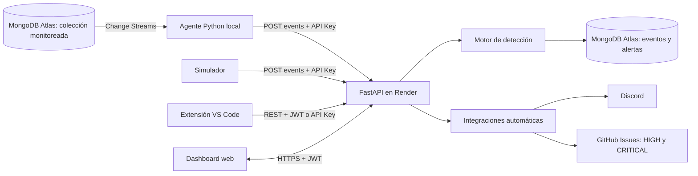
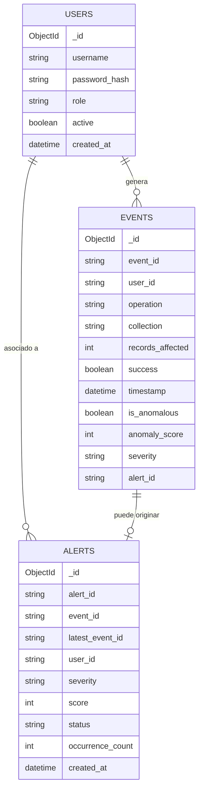
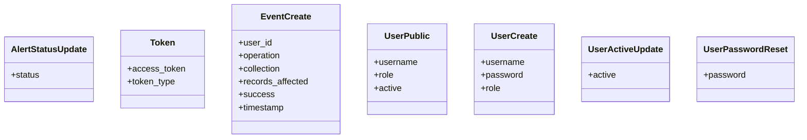
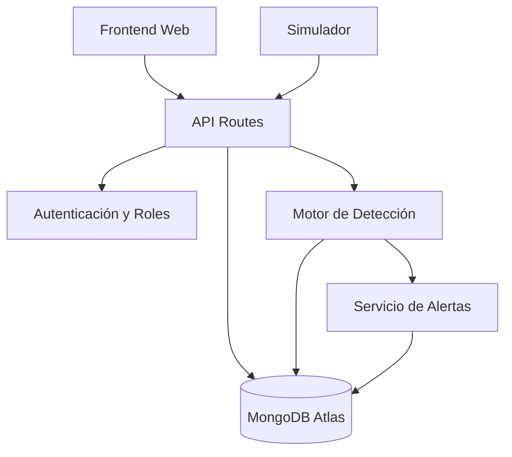
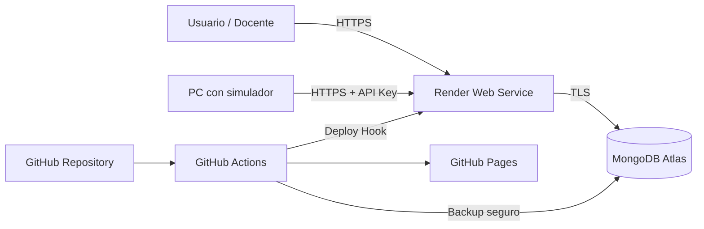

# Sistema web inteligente para la detección de anomalías en bases de datos NoSQL

> Proyecto académico de **Base de Datos 2 - Universidad Privada de Tacna**.

## Estado del proyecto

- Backend: FastAPI.
- Base de datos: MongoDB Atlas.
- Frontend: HTML, CSS y JavaScript.
- Despliegue: Render.
- Autenticación: JWT.
- Ingreso de eventos externos: X-API-Key.
- Documentación técnica: GitHub Pages.
- Backup: GitHub Actions.
- Release y despliegue: GitHub Actions + Render.

**Documentación:** generada desde el código y actualizada con las integraciones de noviembre de 2026.

## Problemática

Las bases de datos NoSQL, como MongoDB, permiten manejar grandes volúmenes de información y múltiples operaciones de forma flexible. Sin embargo, no todas las actividades anormales representan errores directos: un acceso en horario inusual, un incremento repentino de consultas, múltiples operaciones fallidas o una eliminación masiva pueden ser válidas individualmente, pero sospechosas al analizar su comportamiento en conjunto.

El proyecto busca desarrollar una herramienta que no solo registre lo ocurrido, sino que analice los eventos y determine si el comportamiento observado se desvía de los patrones considerados normales, generando alertas que faciliten la supervisión.

### Problema general

**¿Cómo detectar oportunamente anomalías y comportamientos inusuales en las operaciones realizadas sobre una base de datos NoSQL?**

## Objetivos

### Objetivo general de investigación

Analizar patrones de acceso y operaciones en bases de datos NoSQL para establecer criterios que permitan identificar automáticamente comportamientos anómalos.

### Objetivos específicos de investigación

- Identificar al menos 5 tipos de anomalías relevantes en bases de datos NoSQL.
- Determinar variables necesarias para su detección, como usuario, horario, frecuencia y tipo de operación.
- Construir un conjunto de pruebas con eventos normales y anómalos.
- Evaluar el mecanismo buscando una precisión mínima del 80 % en los escenarios definidos.

### Objetivo general de la solución

Desarrollar un sistema web inteligente para detectar anomalías y comportamientos inusuales en bases de datos NoSQL, inicialmente MongoDB, mediante el análisis de eventos y la generación de alertas.

## Arquitectura general



## Estructura principal

```text
backend/
  app/
    auth/          Autenticación JWT y control de roles
    config/        Configuración del sistema
    database/      Conexión a MongoDB
    detection/     Motor y reglas de anomalías
    routes/        Endpoints REST
    schemas/       Modelos Pydantic
    services/      Servicios de alertas
frontend/          Dashboard y vistas web
simulator/         Generador de eventos de prueba
vscode-extension/  Extensión propia para VS Code y pruebas
scripts/           Utilidades y automatizaciones
docs/              Portal de documentación en GitHub Pages
Documentacion/     Informes académicos FD01-FD05 y anexos
.github/workflows/ Automatizaciones GitHub Actions
```

## Diccionario de datos

MongoDB es una base documental y no aplica claves foráneas obligatorias como una base relacional. El siguiente diccionario representa la estructura utilizada por la aplicación.

### Colección `users`

| Campo | Tipo | Descripción |
|---|---|---|
| `_id` | ObjectId | Identificador interno de MongoDB |
| `username` | string | Nombre de usuario único |
| `password_hash` | string | Hash seguro de la contraseña |
| `role` | string | Rol: admin o analyst |
| `active` | boolean | Indica si el usuario está habilitado |
| `created_at` | datetime | Fecha de creación |
| `created_by` | string | Usuario administrador que creó el registro |
| `updated_at` | datetime | Última actualización |
| `updated_by` | string | Usuario que realizó la actualización |

### Colección `events`

| Campo | Tipo | Descripción |
|---|---|---|
| `_id` | ObjectId | Identificador interno de MongoDB |
| `event_id` | string | Identificador funcional EVT-XXXXXXXX |
| `user_id` | string | Usuario asociado al evento |
| `operation` | string | READ, INSERT, UPDATE o DELETE |
| `collection` | string | Colección NoSQL afectada |
| `records_affected` | integer | Cantidad de registros afectados |
| `success` | boolean | Resultado de la operación |
| `timestamp` | datetime | Fecha y hora del evento |
| `analyzed` | boolean | Indica si el motor ya procesó el evento |
| `is_anomalous` | boolean | Indica si se detectó anomalía |
| `anomaly_score` | integer | Puntaje de anomalía de 0 a 100 |
| `severity` | string/null | low, medium, high, critical o null |
| `alert_id` | string/null | Alerta relacionada si corresponde |

### Colección `alerts`

| Campo | Tipo | Descripción |
|---|---|---|
| `_id` | ObjectId | Identificador interno de MongoDB |
| `alert_id` | string | Identificador funcional ALT-XXXXXXXX |
| `event_id` | string | Evento que originó la alerta |
| `latest_event_id` | string | Último evento agrupado |
| `user_id` | string | Usuario asociado |
| `operation` | string | Operación relacionada |
| `collection` | string | Colección relacionada |
| `records_affected` | integer | Registros afectados |
| `types` | array | Tipos de anomalía detectados |
| `signature` | string | Firma utilizada para agrupar alertas |
| `score` | integer | Puntaje de anomalía |
| `severity` | string | low, medium, high o critical |
| `reasons` | array | Razones de la detección |
| `detections` | array | Detalle técnico de las reglas activadas |
| `status` | string | pending, reviewed o resolved |
| `occurrence_count` | integer | Cantidad de eventos agrupados |
| `event_timestamp` | datetime | Fecha del evento |
| `created_at` | datetime | Fecha de creación |
| `updated_at` | datetime | Fecha de actualización |

### Colección `integration_history`

| Campo | Tipo | Descripción |
|---|---|---|
| `_id` | ObjectId | Identificador interno del historial |
| `alert_id` | string | Identificador de la alerta vinculada |
| `provider` | string | Proveedor: discord o github |
| `status` | string/opcional | sent, created, skipped o failed para integraciones automáticas |
| `result` | object | Respuesta o metadatos de la integración |
| `error` | string/null | Motivo de omisión o error, cuando corresponde |
| `executed_by` | string | system o usuario que invocó la integración |
| `created_at` | datetime | Momento de ejecución registrado en UTC |


## Diagrama lógico de entidades

Las relaciones son **lógicas**, basadas en los campos `user_id`, `event_id` y `alert_id`.



## Diagrama de clases

Este diagrama se genera a partir de las clases definidas en `backend/app/schemas`.



## Diagrama de componentes



## Diagrama de despliegue



## Reglas de detección implementadas

| Regla | Condición principal | Resultado |
|---|---|---|
| Operación masiva | DELETE o UPDATE con gran cantidad de registros | Alerta por operación masiva |
| Horario inusual | Operaciones entre 00:00 y 05:59 | Incrementa el puntaje |
| Alta frecuencia | Muchas operaciones del mismo usuario en una ventana corta | Alerta por frecuencia |
| Fallos repetidos | Varias operaciones fallidas recientes | Alerta por fallos |
| Desviación de comportamiento | Valor significativamente diferente al histórico | Alerta estadística |

### Severidad

| Puntaje | Severidad |
|---:|---|
| 1-24 | low |
| 25-49 | medium |
| 50-74 | high |
| 75-100 | critical |

## Seguridad

### JWT

Se utiliza para autenticar a los usuarios de la aplicación. Los roles implementados son:

- `admin`: administración de usuarios y acceso al sistema.
- `analyst`: consulta y análisis de eventos y alertas.

### API Key

El endpoint `POST /events` valida el encabezado `X-API-Key` para evitar que clientes no autorizados inyecten eventos.

Los secretos reales no se almacenan en el repositorio. Se gestionan mediante variables de entorno y GitHub Secrets.

## Automatizaciones de GitHub

| Workflow | Objetivo |
|---|---|
| Documentación técnica - GitHub Pages | Genera y publica documentación técnica |
| Backup automático MongoDB | Genera copias de seguridad y un reporte como artifact |
| Release y despliegue Render | Crea releases y dispara el despliegue en Render |
| Documentación automática README | Regenera este README, diccionario y diagramas |

## Ejecución local

1. Crear y activar un entorno virtual.
2. Instalar dependencias:

```bash
pip install -r requirements.txt
```

3. Configurar un archivo `.env` a partir de `.env.example`.
4. Ejecutar:

```bash
uvicorn backend.app.main:app --reload
```

## Simulación

Ejemplo de demostración completa:

```bash
python simulator/simulator.py --mode demo
```

## Documentación académica

La carpeta `Documentacion/` contiene los documentos académicos (Visión, Factibilidad, SRS, SAD, FD05, estándar y diccionario de datos). También incluye el **[Anexo FD05 de integraciones](Documentacion/FD05_Anexo_Integraciones_CALDERON_MANGO_2026.md)**, complemento posterior que preserva el PDF original.

La [extensión para Visual Studio Code](vscode-extension/README.md) dispone de instalación, configuración, pruebas y empaquetado propios.

## Fuentes base

- OWASP Foundation - NoSQL Security Cheat Sheet.
- MongoDB - Auditing.
- MongoDB Atlas - Monitoring and Alerts.

---

Este README es actualizado mediante una automatización de GitHub Actions a partir de la estructura y documentación técnica del proyecto.

## Reto de integraciones: Discord, GitHub Issues y Visual Studio Code

La aplicación incorpora **tres puntos de integración demostrables**. Las dos primeras integraciones son acciones automáticas del backend ante una alerta nueva; la tercera es una extensión nativa de VS Code que consume la API existente. **Son integraciones de naturaleza diferente**, no tres sistemas de notificación.

| Integración | Disparador y funcionamiento | Evidencia |
|---|---|---|
| **Discord** | Enviar aviso cuando se crea una alerta nueva y hay webhook configurado. | Registro `discord: sent` en `integration_history`. |
| **GitHub Issues** | Crear Issue automáticamente si la severidad es **high** o **critical**. Para severidad baja/media se omite. | [Issue #6: CRITICAL, ALT-ED529A2F](https://github.com/JuanCalderon1218/Proyecto-Base-de-datos-2/issues/6). |
| **Visual Studio Code** | La extensión **NoSQL Anomaly Monitor** consulta eventos/alertas y envía pruebas a `POST /events`. | [Código y guía de instalación](vscode-extension/README.md). |

### Flujo verificado desde VS Code

1. Abrir el panel **NoSQL Anomaly Monitor** e iniciar sesión con JWT para consultar el dashboard.
2. Guardar la `EVENT_API_KEY` en **SecretStorage** para enviar eventos.
3. Enviar una lectura normal (READ de 3 registros): **Score 0, NORMAL**, sin alerta.
4. Enviar la prueba sintética DELETE de 1 500 registros: **MASS_DELETE, Score 75, CRITICAL**.
5. Comprobar el evento `EVT-7F5D97E3`, la alerta `ALT-ED529A2F`, la notificación **Discord sent** y la incidencia **GitHub created** ([Issue #6](https://github.com/JuanCalderon1218/Proyecto-Base-de-datos-2/issues/6)).

**Alcance:** las pruebas enviadas desde VS Code **no borran documentos reales**; registran eventos de prueba en la API. El agente Python separado utiliza **MongoDB Change Streams** para observar inserciones, actualizaciones y eliminaciones reales; las lecturas y operaciones fallidas requieren eventos instrumentados o simulados. El agente de pruebas continúa ejecutándose desde la PC mientras no se despliegue como servicio permanente.

**Publicación:** la extensión funciona instalada por VSIX; el publicador del Marketplace es `calderonmango`. La disponibilidad pública debe comprobarse en Microsoft, sin asumir que la revisión ya terminó.

**Documentación adicional:** [Guía técnica e integraciones en GitHub Pages](https://juancalderon1218.github.io/Proyecto-Base-de-datos-2/integraciones/) · [Anexo académico FD05](Documentacion/FD05_Anexo_Integraciones_CALDERON_MANGO_2026.md).

---
